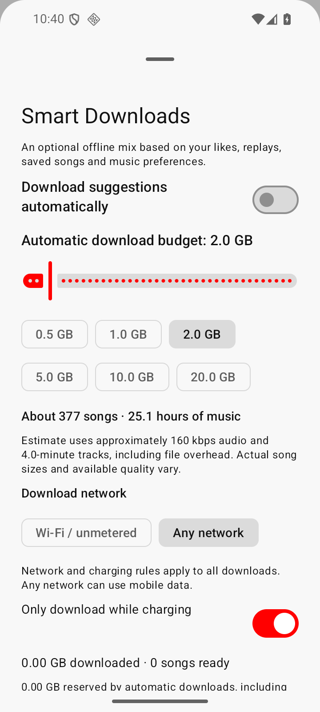

<p align="center"></p>

# Heer Music

**Music, discovery and offline listening by Heer Labs.** An independent Android music app built on the open-source Flow project.

## Features

- Punjabi-first artist, language and era preferences, with local personalised recommendations.
- Song and Video switching when a matching music video is available.
- Like to save a song for offline listening; Dislike removes its downloaded audio from the phone and excludes the recording from recommendations.
- Smart Downloads with a selectable GB budget, estimated song count and listening hours, and visible network/charging/storage status.
- Playlists, offline audio, background playback and Android Auto integration inherited from Flow and extended for Heer Music.
- Listening history and personalised ranking stay on the phone. Online catalogue and playback requests still contact the music services.

<p></p>

## Downloads

Signed test APKs are published under [Releases](https://github.com/kangaroosingh/heer-music/releases). Test previews require phone and car validation before being considered stable.

Existing Flow Music preview installations can update using the same Android package and signing key. Internal package names are retained for compatibility with saved libraries and downloads.

## Development

Use JDK 21+ and Android SDK, then run the flavour-prefixed tasks:

```sh
./gradlew ktlintCheck :app:assembleFossDebug :app:testFossDebugUnitTest
```

The FOSS build has no automatic updater. Report Heer Music issues in [this repository](https://github.com/kangaroosingh/heer-music/issues).

## Credits and licence

Heer Music is maintained and customised by **Heer Labs**. It is derived from **[Flow by Flow-Tube and A-EDev](https://github.com/Flow-Tube/Flow)**, whose original authors and contributors retain credit and copyright. This project is independent and is not the official Flow distribution.

The source remains under **GPLv3**; see [License](License). Existing third-party notices, NewPipeExtractor and dependency credits are preserved. The Heer Music name and logo identify this independent distribution.
